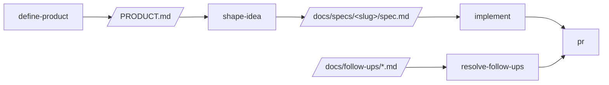

# Claude Code Playbook Template

[](https://www.claude-hunt.com)
[](https://docs.claude-hunt.com)

> [Claude Hunt](https://www.claude-hunt.com) 강의용 Next.js 16 + React 19 템플릿.
> 사용법과 워크플로우 문서는 [docs.claude-hunt.com](https://docs.claude-hunt.com)에서 확인하세요.

## 기술 스택

Next.js 16 (App Router) · React 19 · Tailwind CSS 4 · shadcn/ui · Bun · Vitest · Playwright

## 시작하기

```bash
bun install
bun dev
```

[http://localhost:3000](http://localhost:3000)에서 결과를 확인할 수 있습니다.

## 출퇴근 출발 알림 설정

`.env.local`(배포 시 Vercel 환경변수)에 아래 값을 둡니다.

| 변수 | 설명 |
|---|---|
| `DATA_GO_KR_SERVICE_KEY` | 공공데이터포털 일반 인증키(Decoding). 서울 버스·기상청 단기예보 공용 |
| `NEXT_PUBLIC_SUPABASE_URL` | Supabase 프로젝트 URL |
| `SUPABASE_SECRET_KEY` | Supabase secret 키(`sb_secret_...`) 또는 `service_role` 키. 서버에서만 사용 |
| `APP_SECRET` | 설정 화면·위젯 JSON을 여는 비밀 키. `/?key=<APP_SECRET>`로 접속 |
| `NEXT_PUBLIC_VAPID_PUBLIC_KEY`, `VAPID_PRIVATE_KEY` | 웹 푸시 VAPID 키. `bunx web-push generate-vapid-keys`로 생성 |
| `VAPID_SUBJECT` | `mailto:` 연락처 |
| `CRON_SECRET` | `pg_cron`이 `/api/dispatch`를 부를 때 쓰는 Bearer 값 |

DB는 Supabase SQL Editor에서 `supabase/migrations/20261119000000_commute_notice.sql`을 실행해 만들고, 배포 후 `supabase/cron-dispatch.sql`의 자리표시자를 바꿔 실행하면 매분 발송 확인이 시작됩니다. 출시 후 점검은 `bun docs/specs/commute-departure-notice/check-send-timeliness.ts`로 합니다.

## 스크립트

| 명령어 | 설명 |
|---|---|
| `bun dev` | 개발 서버 실행 |
| `bun run build` | 프로덕션 빌드 |
| `bun start` | 프로덕션 서버 실행 |
| `bun run lint` | ESLint 실행 |
| `bun run typecheck` | `tsc --noEmit` 타입 검사 |
| `bun run test` | Vitest 단위/컴포넌트 테스트 1회 실행 |
| `bun run test:watch` | Vitest watch 모드 |
| `bun run test:e2e` | Playwright E2E 테스트 실행 |

## 테스트

- **단위·컴포넌트**: Vitest + Testing Library. 설정은 `vitest.config.mts`, 매처와 cleanup은 `vitest.setup.ts`에 있습니다. 테스트 파일은 소스 옆에 `*.test.ts(x)`로 둡니다(`lib/utils.test.ts` 참고). `globals`를 켜지 않았으므로 `describe`/`it`/`expect`는 `vitest`에서 import 합니다.
- **E2E**: Playwright. 설정은 `playwright.config.ts`, 테스트는 `e2e/*.spec.ts`에 둡니다. `webServer`가 `bun run dev`를 자동으로 띄우므로 별도 서버 실행이 필요 없습니다.

E2E를 처음 실행하기 전에 브라우저를 한 번 내려받아야 합니다.

```bash
bunx playwright install chromium
```

브라우저가 이미 설치된 환경(예: Claude Code 원격 세션)에서는 내려받는 대신 실행 파일 경로를 지정할 수 있습니다.

```bash
PLAYWRIGHT_CHROMIUM_PATH=/opt/pw-browsers/chromium bun run test:e2e
```

`async` Server Component는 Vitest가 아직 지원하지 않으므로 E2E로 검증합니다.

- **런타임 검증(에이전트용)**: [agent-browser](https://github.com/vercel-labs/agent-browser). 에이전트가 `next-dev-loop` 스킬로 실행 중인 앱을 직접 조작해 변경을 확인할 때 씁니다. 프로젝트 의존성이 아니므로 한 번 전역으로 설치합니다.

```bash
npm i -g agent-browser
agent-browser install  # 설치된 Chrome이 없을 때만
```

## Claude Code 워크플로우



파이프라인 밖에서는 `project-knowledge`, `maintain-project-context`, `add-stack-context`, `build-prototype`, `explain-visually`, `tdd`, `llm-evals`가 각자의 조건에 따라 켜집니다. `project-knowledge`는 `GLOSSARY.md`, `docs/decisions/`, `docs/follow-ups/`에 다음 작업에서도 재사용할 지식과 후속 항목을 남깁니다. Git 작업은 `commit`, `pull`, `push`, `pr`, `merge`, `clean-branches`가 해당 요청에 맞춰 처리합니다.
